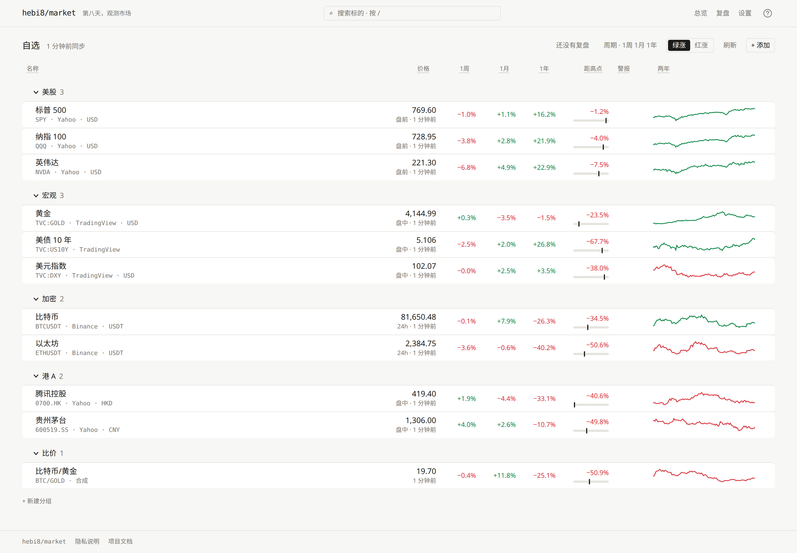
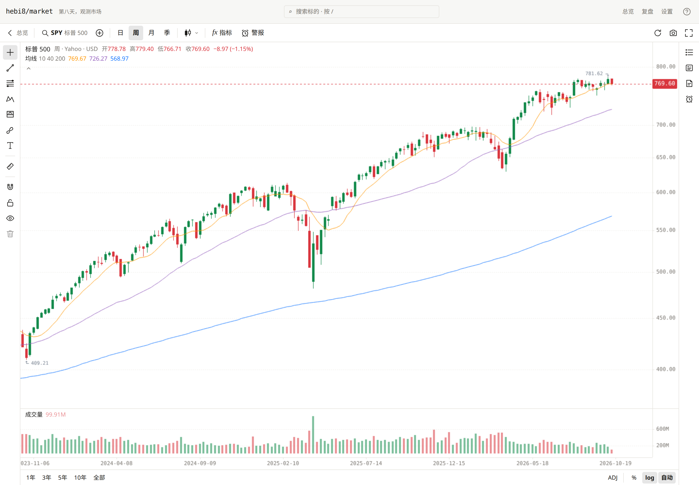

English | [中文](README.cn.md)

# hebi8/market

> hebi (蛇), the snake, bites its own tail: seven days make one turn, and the eighth day, left over, is for watching the market.

A self-hosted market dashboard for a weekly review, not a TradingView replacement. It pulls daily bars after each close; once a week you scan the watchlist, look closer at a few charts and write down what you think.

| Step | Page | The question it answers |
|---|---|---|
| Scan | `/` overview: grouped table, my alerts, this week's triggers | Where does everything I follow stand right now? |
| Look closer | `/chart/[key]` chart: candles, indicators, compare, drawings, notes | How are the few worth a closer look shaped, and how do they compare with others? |
| Write down | `/review` review: this week's journal, last week's, a summary of this week's changes | What did I think last week, and what do I think now? |



Next.js + [KLineChart](https://github.com/klinecharts/KLineChart) + SQLite. Your watchlist, notes and drawings live in a `vault/` directory of YAML and Markdown; the database is only a cache. The interface is in Chinese.

The author's own instance runs at <https://market-hebi8.dreaife.tokyo>: without logging in you can look through the author's watchlist and charts, but not change them.

## Features



- **Search**: `/` or `Ctrl/Cmd+K`. Finds symbols by Chinese name, pinyin or initials, and asks Yahoo / TradingView / Binance when nothing local matches.
- **Overview**: latest price, change, distance from the high, alerts and a weekly sparkline, by group; sorting, dragging and renaming are written back to `hebi8.yaml`.
- **Chart**: TradingView's layout and hotkeys, with indicators, compare, 50+ drawing tools, measuring and snapshots.
- **Synthetic symbols**: type an expression such as `AAPL/MSFT` or `2*(SPY-QQQ)` and chart it, compare it and set alerts on it like any other symbol.
- **Alerts and notifications**: TradingView's conditions or a formula of your own, checked every 5 minutes during market hours and pushed to Telegram, a webhook or web push.
- **Formulas and code indicators**: one formula language for chart indicators, alerts and comparisons; logic it can't express can be written as a code indicator.
- **Notes and review**: a markdown note per symbol and a review journal per week, saved as you type.
- **Symbol details**: description, sector, market cap, fund holdings and related links; one click translates the description into Chinese.
- **Moving from TradingView**: import and export watchlists, and import drawings by layout.
- **Agents (MCP)**: give an agent a token and it can read prices, scan your watchlist with formulas and save alerts for you.
- **Shared instance**: a few people log in with GitHub and share one instance, each with a vault of their own; visitors who don't log in can only look.

Every feature in full, with the hotkey table, is in [docs/usage.md](docs/usage.md).

## Quick start

Requires Node.js 20.9 or later (production runs Node 22).

```bash
npm install
npm run dev        # http://localhost:3000
```

On first open it copies `vault.example/hebi8.yaml` to `vault/hebi8.yaml` and pulls the full history in the background, which takes a few seconds. After that the in-app scheduler syncs every day at the times in `sync.at`, and catches up once when the app starts after being stopped for a while. 刷新 (Refresh), top right on the overview, forces a full sync.

For production, `npm run build && npm start`. Environment variables, the vault and shared instances are covered in [docs/self-hosting.md](docs/self-hosting.md).

Out of the box it is single-user with no login, and anyone who can open the page can change everything, so keep it on a private network; to put it on the internet, first set `owner` in `hebi8.yaml` to make it a shared instance (see [On the public internet](docs/self-hosting.md#放到公网)). Only daily bars are stored; weekly, monthly and quarterly bars are built on read. Reads never touch the network, and notifications only go out: the app opens no inbound endpoint for them.

## Data sources

| source | Covers | Notes |
|---|---|---|
| `yahoo` | US, Hong Kong and China A-share stocks, indices, ETFs | Full daily history through [yahoo-finance2](https://github.com/gadicc/yahoo-finance2). Prices are split-adjusted; the dividend factor is stored separately and folded into prices with `prices: total`. |
| `binance` | Crypto spot | The public kline API, no key needed, fetched incrementally. |
| `tv` | Indices, government bond yields, FX, commodities and other markets Yahoo lacks | The unofficial [TradingView-API](https://github.com/Mathieu2301/TradingView-API), no login, the full daily history (TVC:DJI goes back to 1896). It is a reverse-engineered API and may stop working. |
| `data` | Your own daily datasets, such as second-hand GPU prices a scraper pushes every day | A git repository or local directory of CSV files laid out by convention; hebi8 only reads it and never scrapes. See [custom datasets](docs/usage.md#自定义数据集). |

Key examples: `yahoo:AAPL`, `yahoo:0700.HK`, `yahoo:600519.SS`, `yahoo:^GSPC`, `binance:BTCUSDT`, `tv:TVC:US10Y`, `tv:HSI:HSTECH`, `tv:FX_IDC:USDCNH`, `data:gpu/4090-xianyu`, `=BTC/GOLD`.

## Docs

The docs are in Chinese, except `docs/architecture.md`, which is in English.

| Doc | Contents |
|---|---|
| [docs/usage.md](docs/usage.md) | Every feature in full, hotkeys, formulas, alerts and notifications, code indicators, connecting over MCP |
| [docs/self-hosting.md](docs/self-hosting.md) | Running and updating in production, environment variables, the vault, checking on an instance, shared instances, the public internet, web login |
| [docs/architecture.md](docs/architecture.md) | Code map and conventions: the vault, viewers, quotes and alerts, MCP, symbol details, indicators |
| [docs/maintainers.md](docs/maintainers.md) | Doc conventions, the GitHub App for feedback, issue labels, branches and releases, source tree, verification |
| [docs/design.md](docs/design.md) | Design spec: data model, sync, APIs, page behaviour |
| [CHANGELOG.md](CHANGELOG.md) | What changed in each version; read 升级注意 (upgrade notes) before upgrading |

## License

[Apache-2.0](LICENSE)
