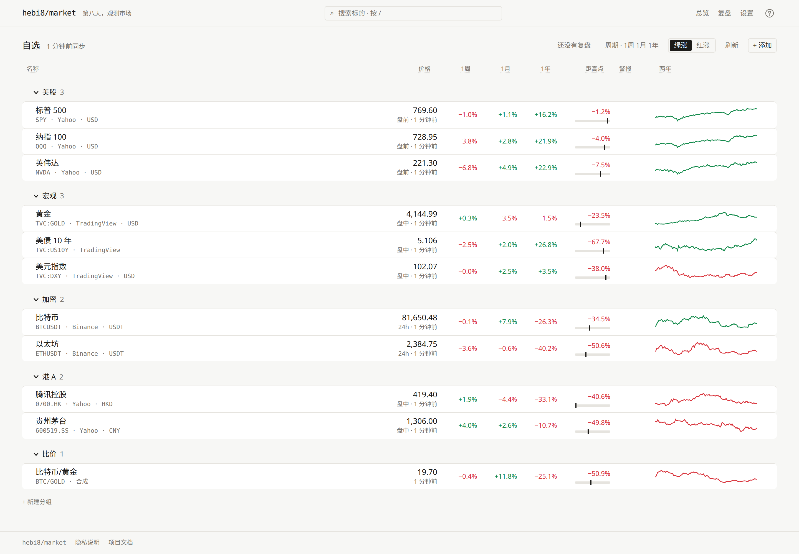
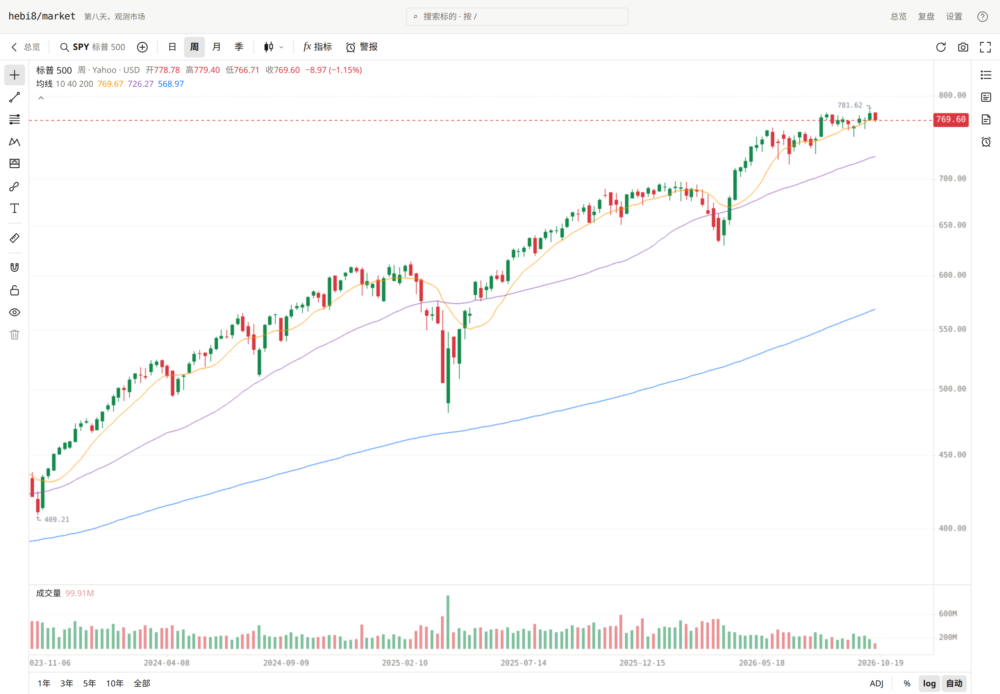

# hebi8/market

> hebi（蛇）首尾相衔，七天一个轮回；多出来的第八天，用来观测市场。

一个自己部署的长线看盘面板，用来做每周复盘，不是 TradingView 的替代品。每天收盘后自动拉日线；第八天打开时做三件事：

| 动作 | 页面 | 回答的问题 |
|---|---|---|
| 扫描 | `/` 总览：分组表格、我的警报、本周触发 | 我关心的东西现在各处于什么状态？ |
| 深看 | `/chart/[key]` 图表：K 线、指标、对比、画线、笔记 | 值得细看的几个，结构是什么样？和别的比呢？ |
| 记录 | `/review` 复盘：本周日志、上周日志、本周变化汇总 | 上周怎么想的，这周怎么想？ |



Next.js + [KLineChart](https://github.com/klinecharts/KLineChart) + SQLite。你的自选、笔记、画线都存在一个 YAML + Markdown 的 `vault/` 目录里，数据库只是缓存。

## 功能



- **搜索**：`/` 或 `Ctrl/Cmd+K`，中文名、拼音、首字母都能搜，本地没有再查 Yahoo / TradingView / Binance。
- **总览**：按分组列出最新价、涨跌、距高点、警报和周线迷你图；排序、拖动、改名都写回 `hebi8.yaml`。
- **图表**：布局和快捷键照搬 TradingView，有指标、对比、50 多种画线工具、测量和快照。
- **合成标的**：直接输 `AAPL/MSFT`、`2*(SPY-QQQ)` 这样的表达式，当作普通标的看图、对比、设警报。
- **警报与通知**：照 TradingView 的条件，或者自己写公式；盘中每 5 分钟判断一次，推到 Telegram、webhook 或网页推送。
- **公式与代码指标**：一套公式语言，图表指标、警报、对比都用它；写不出来的逻辑可以写成代码指标。
- **笔记与复盘**：每个标的一篇 markdown 笔记，每周一篇复盘日志，自动保存。
- **商品详情**：简介、行业、市值、基金持仓和相关链接，简介可以一键翻成中文。
- **从 TradingView 搬家**：导入导出自选列表，按布局导入画线。
- **让 agent 接入（MCP）**：给 agent 一个令牌，让它读行情、用公式扫自选、帮你存警报。
- **多人共用**：局域网里几个人用 GitHub 登录共用一台实例，各人的 vault 分开。

每项功能的完整说明和快捷键表见 [docs/usage.md](docs/usage.md)。

## 快速开始

需要 Node.js。

```bash
npm install
npm run dev        # http://localhost:3000
```

首次打开会把 `vault.example/hebi8.yaml` 复制为 `vault/hebi8.yaml`，并在后台拉取全部历史，大约几秒。之后由应用内的调度器按 `sync.at` 的时间每天同步；应用停过一段时间再启动时会补跑一次。总览右上角的「刷新」强制全量同步。

生产模式 `npm run build && npm start`。环境变量、vault 和多人共用见 [docs/self-hosting.md](docs/self-hosting.md)。

默认单用户、无登录、只在内网用；只存日线，周 / 月 / 季线读时合成；读取永远不碰网络；通知只往外发，不开任何入口。

## 数据源

| source | 覆盖 | 说明 |
|---|---|---|
| `yahoo` | 美股、港股、A 股、指数、ETF | 经 [yahoo-finance2](https://github.com/gadicc/yahoo-finance2) 拉取完整日线历史。价格是拆股复权价，分红因子另存，`prices: total` 时折进价格。 |
| `binance` | 加密货币现货 | 公开 K 线接口，无需 key，增量拉取。 |
| `tv` | 指数、国债收益率、外汇、商品等 Yahoo 缺的品种 | 非官方的 [TradingView-API](https://github.com/Mathieu2301/TradingView-API)，无需登录，取全部日线（如 TVC:DJI 从 1896 年起）。属于逆向接口，可能失效。 |
| `data` | 自己的日线数据集，比如爬虫每天推送的显卡二手价 | 一个按约定放 CSV 的 git 仓库或本机目录，hebi8 只读不爬，见[自定义数据集](docs/usage.md#自定义数据集)。 |

代码示例：`yahoo:AAPL`、`yahoo:0700.HK`、`yahoo:600519.SS`、`yahoo:^GSPC`、`binance:BTCUSDT`、`tv:TVC:US10Y`、`tv:HSI:HSTECH`、`tv:FX_IDC:USDCNH`、`data:gpu/4090-xianyu`、`=BTC/GOLD`。

## 文档

| 文档 | 内容 |
|---|---|
| [docs/usage.md](docs/usage.md) | 各功能的完整操作、快捷键、公式、警报和通知、代码指标、MCP 接入 |
| [docs/self-hosting.md](docs/self-hosting.md) | 生产运行和更新、环境变量、vault、查看实例状态、多人共用、网页登录 |
| [docs/maintainers.md](docs/maintainers.md) | 文档约定、反馈用的 GitHub App、issue 标签、源码结构、验证命令 |
| [docs/design.md](docs/design.md) | 设计文档：数据模型、同步、接口、页面行为 |

## License

Apache-2.0
